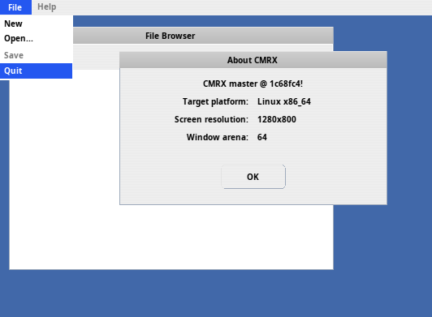
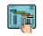

# Contraption GUI library

**Contraption** /kən-trăp′shən/

*noun*

​- a machine or piece of equipment that looks strange or 
  complicated and possibly does not work well
  

  

## About

Contraption is a GUI library originally created for 2026 FOSDEM
talk on CMRX transaction engine. In fully featured build it 
integrates both widget rendering and window management.

Contraption implements completely server-side and server-owned 
rendering. Application uploads GUI description to server and
let it render the desktop. Client provides server with description 
of window(s), its content and menus. Server doesn't send any expose 
events to applications in order to render the screen. This
rendering scheme is derived from Amiga OS Intuition window server.

Contraption Window server uses compile-time defined pools for 
objects and does not allocate any memory dynamically so it is
well suited for embedded systems.

This rendering scheme was used to enable graphical user 
interfaces on top of [CMRX RTOS](https://github.com/ventZl/cmrx) which is memory protected.
Classic GUI interfaces like LVGL are not suitable for this environments
as rendering is client-driven with "server" performing callbacks to
applications owning widget instances.

As of now the library is WIP and kind-of experimental.

## Using Contraption

Contraption exposes RPC interface. Any client wanting to
display its windows must use it. First method any client must
call is:

~~~
open_connection()
~~~

This method provides client's pointer to object server can notify
when there's even ready for client, client's user-visible name
and client's connection flags.

Once the connection is open, client can upload GUI. Contraption
recognizes two main top-level objects:

* windows
* menus

They are both basically the same structure - area with defined
dimension, background color and gadgets. Contraption manages menus 
automatically using master menu bar in way similar to Amiga OS 
and Apple Mac OS. Only menu bar of window having focus is displayed.

Content of window is defined by the means of listing gadgets
window contains. Gadgets represent individual UI building blocks,
such as buttons, input boxes, radio buttons, etc. Applications will
specify where in the window gadget is, what are its properties and
Contraption will both draw the gadget and implement its behavior.

New window is creates using RPC method:

~~~
open_window()
~~~

This will allocate Window ID in server. Then the application can
load list of gadgets using RPC method:

~~~
load_window()
~~~

This method is given Window ID obtained by `open_window()` and array
describing Gadgets. If this function is called on windows which already
has content already loaded, the old content is dropped and replaced by
new content. Once window is loaded, it can be shown using 

~~~
raise_window()
~~~

Menu can be opened using RPC method

~~~
open_menu()
~~~

This menu works basically the same as `open_window()`. The main 
diffence is that window is marked as menu and cannot be freely mapped.
Contraption will also automatically manage window's dimension.

Application can attach menu to window calling RPC method

~~~
attach_menu()
~~~

Which will instruct Contraption to automatically show given menu when
said application window has input focus.

Window content manipulation is possible using two additional methods:

~~~
write_gadget()
~~~

Allow replacement of single gadget in window. You can't add new widget, 
nor remove old widget. The point of using this function is to 
programmatically change widget's content or appearance (such as 
disabling menu item).

Contraption holds values of input elements in gadget properties. If
application wants to read these, it can use

~~~
read_gadget()
~~~

which retrieves complete gadget description for one gadget in window.

Aside from window manipulation, client can upload images for use with
PIXMAP gadget. Client can also set this icon as client's connection icon
and Contraption may decide to use it to represent client's windows.

If an event is generated client opted being notified of, Contraption
will generate an asynchronous notification on object client specified
during opening connection. If this happens, client must call

~~~
get_event()
~~~

method, which will retrieve the event. If there is no event queued, method
will return false.

## Gadget types

Gadgets wrap both look and feel of UX elements applications can put into
window. Following is the list of gadget types Contraption currently supports:

### BUTTON

This gadget represents pushbutton with text label. This button can be 
pressed, released and disabled. Event can be generated when the button is
pressed.

### TEXT

Plain, passive text. Color, font size and font effects (bold, italic) can be
set. Text can't generate any events.

### TITLE BAR

Window title bar. This gadget implements window dragging and is automatically
resized when window resizes. Contraption will also place it on top of window.

### RADIO

Radio button. It can be selected or not, enabled or disabled.

### CHECKBOX

Checkbox, it can be checked or unchecked, enabled or disabled. Checking checkbox
may generate an event.

### TEXT INPUT

Text input is single-line input box user can change its value.

### MENU ITEM

Menu items in menu bars and drop-down menus.

### PANEL

Panel that can be used to visually group gadgets. It has no other function.

### PIXMAP

Image. Client must upload pixmap into server and then pass pixmap ID to the gadget.

### HIDDEN

If gadget type is changed to "hidden" then Contraption ignores it. Applications
can change gadget type to type "hidden" to effectively remove it from window
without removing all the data.

## Rendering

Contraption performs front-to-back rendering with every pixel being rendered only once.

You can create gadgets fully manually or use macros in `factory.h` header to easily
get standard kinds of gadgets.

## Drawing surface

Contraption itself doesn't manage any drawing device. It expects presence of 
service supporting following RPC interface:

~~~
blit()
~~~

Use source rectangular ARGB pixmap as texture to fill target rectangular area.

~~~
line()
~~~

Draw line given start and end coordinates.

~~~
arc()
~~~

Draw arc.

~~~
arc_fill()
~~~

Draw and fill arc.

~~~
text()
~~~

Write text using previously set text properties.

~~~
text_measure()
~~~

Measure what dimensions text would have if rendered. Will perform no actual output.
Properties set using `set_font()` are accepted when calculating dimensions.

~~~
cull()
~~~

Set culling rectangle. All drawing operations will be confined to this window and
no output will happen outside it.

~~~
set_font()
~~~

Set properties of subsequent font drawing operations.

Any server which supports this API can be used as rendering backend for 
Contraption UI library.
